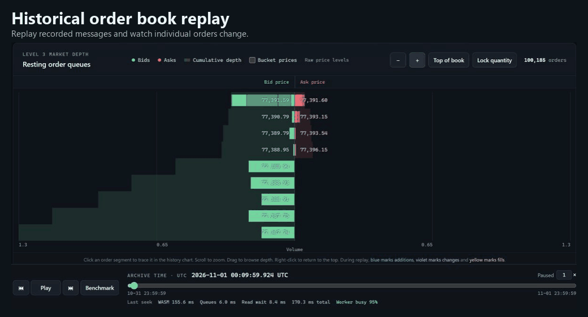

# BTC Market Feed

A Rust and Kafka pipeline for market-by-order (L3) data in the browser. It streams synthetic BTC spot and futures order messages and reconstructs each order queue live.

## Live order messages

Follow one resting order as a Kafka message changes its size. A later partial fill updates the book, the strategy’s remaining order and the price chart together.


## Historical order book replay

A separate demo reconstructs historical L3 books from recorded order messages and replays them in the browser.



## Run the demo

```sh
docker compose up --build --wait
```

Open [the feed walkthrough](http://127.0.0.1:4330/). In [manual mode](http://127.0.0.1:4330/?manual=1), use **Next** or the right arrow to step through the events. Open circles on the price chart mark order placement. Solid circles mark fills.

[The full demo](http://127.0.0.1:4330/?view=full) lets you compare entry and hedge rules using L3 order identities or L2 aggregate depth. Both modes use synthetic data and simulated executions.

## Data path

```text
Seeded market + FIFO matcher → Kafka → Rust HTTP API → JavaScript event projector → browser
```

Each session uses ordered market events and separate acknowledgements and fills. The server reads back the corresponding Kafka records before returning the next HTTP event batch. The browser uses event sequence numbers and source timestamps to apply updates, maintain queues and place markers on the price charts. The API accepts revision numbers so a retried request can recover the same reply without advancing the simulation twice.

The browser advances the market in steps, so the walkthrough can pause at a specific event. This is a local demo with a single broker. Compose binds the web app to loopback and keeps the broker inside the Compose network.

## Verify

With Rust 1.98 and Node.js 22 or later:

```sh
cargo test --locked --jobs 1
node --test web/*.test.mjs
node scripts/protocol-smoke.mjs --kafka
node scripts/live-showcase-smoke.mjs
```

The final script checks that the walkthrough sees both the amendment and the partial fill through Kafka. To emit the ordered events and canonical book checkpoints as JSON Lines, run:

```sh
docker compose exec -T app /app/bin/btc-execution-lab --verify-day --kafka --duration-seconds 60 > kafka-check.jsonl
```

Omit `--duration-seconds 60` for a full simulation day. `docker compose down` stops the demo.
