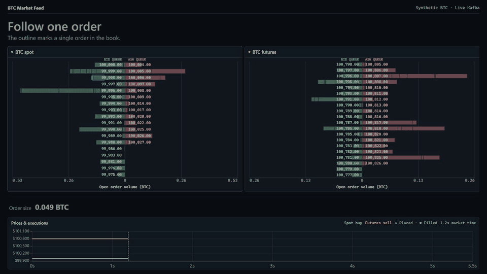
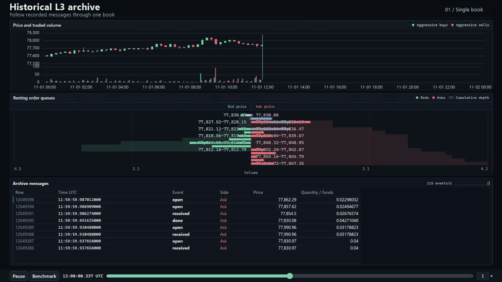

# BTC Market Feed

A Rust and Kafka pipeline for market-by-order (L3) data in the browser. It streams synthetic BTC spot and futures order messages and reconstructs each order queue live.

## Live order messages

Follow one resting order through a size amendment, then watch the example strategy place a spot buy and a futures sell. A partial fill updates the futures book, remaining order size and price chart together.



## Historical L3 archive

A separate demo starts with one historical L3 book and expands to 30 books running together, with a live count of messages processed per second.



## Run the demo

With Docker Engine and the Compose plugin running, enter this from the repository root.

```sh
docker compose up --build --wait
```

Open [the automatic feed walkthrough](http://127.0.0.1:4330/). It pauses on the key scenes and advances on its own. In [manual mode](http://127.0.0.1:4330/?manual=1), use **Next** or the right arrow to step through the same scenes. Open circles on the price chart mark order placement. Solid circles mark fills.

[The full demo](http://127.0.0.1:4330/?view=full) lets you compare entry and hedge rules using L3 order identities or L2 aggregate depth. Both modes use synthetic data and simulated executions.

## Data path

```text
Seeded market + FIFO matcher → Kafka → Rust HTTP API → JavaScript event projector → browser
```

The Rust service sends market updates and strategy execution events to separate Kafka topics. It validates the broker readback and merges the records in sequence before sending each HTTP batch. The browser applies that order to reconstruct FIFO queues and uses source timestamps for the price chart.

Each session serialises commands by revision. An identical retry of the most recent accepted command returns its cached reply. If Kafka delivery fails partway through a batch, the session stops at its last accepted revision and needs a restart.

The browser requests each step, so the walkthrough can pause at a specific event. Compose runs one broker on its internal network and publishes the web app on loopback. Normal session close and eviction delete their topics. An interrupted container can leave topics in the broker volume.

## Verify

Run the unit tests with Rust 1.98 and Node.js 22 or later.

```sh
cargo test --locked --jobs 1
node --test web/*.test.mjs
```

With the Compose stack running, check revision handling and the walkthrough’s underlying Kafka event stream.

```sh
node scripts/protocol-smoke.mjs --kafka
node scripts/live-showcase-smoke.mjs
```

The second script verifies the amendment, order placement and partial fill in sequence. To emit ordered events and canonical book checkpoints as JSON Lines, run the verifier in the app container.

```sh
docker compose exec -T app /app/bin/btc-execution-lab --verify-day --kafka --duration-seconds 60 > kafka-check.jsonl
```

Omit `--duration-seconds 60` for a full simulation day. `docker compose down` stops the demo.
